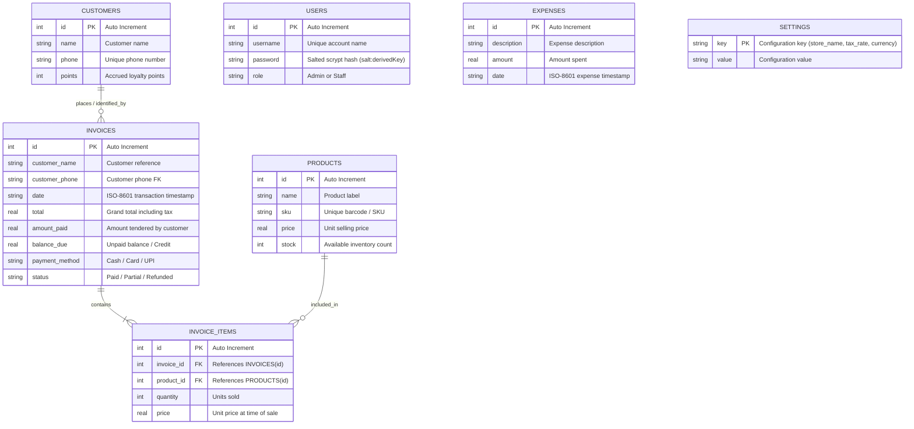
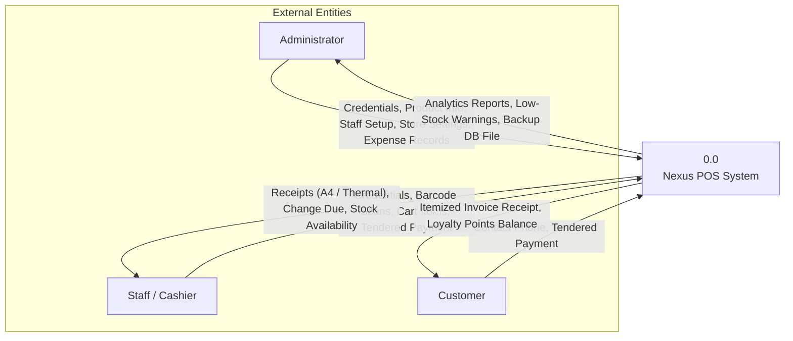
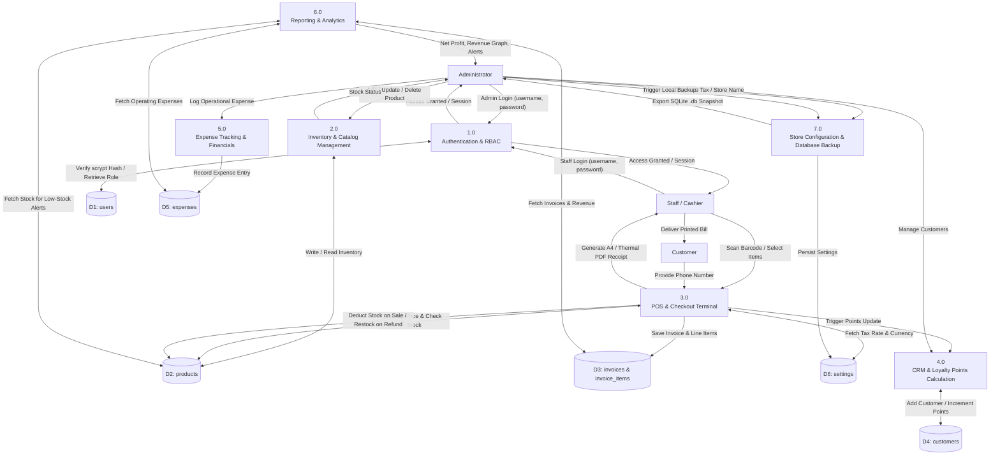
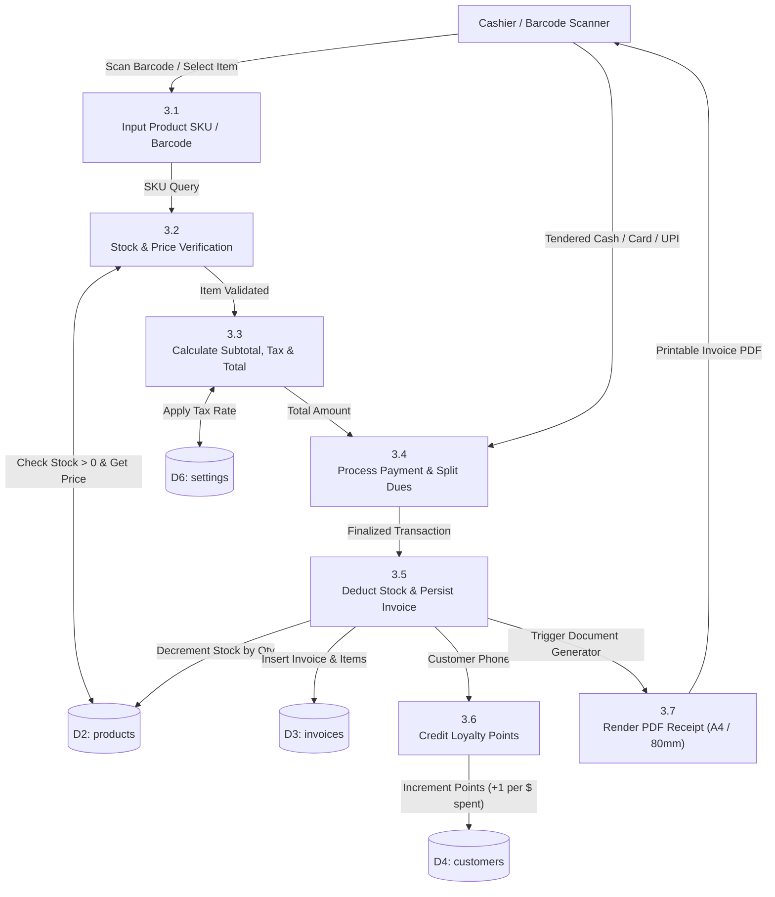

# Nexus POS - Data Flow Diagrams (DFD) & Entity Relationship Diagram (ERD)

This document provides formal architectural models (**DFD Level 0, Level 1, Level 2** and **ERD with Data Dictionary**) for academic reports, system design specifications, and professor reviews.

---

## 1. ENTITY RELATIONSHIP DIAGRAM (ERD)

The relational schema is normalized and stored locally in SQLite (`inventory_billing.db`).

### Relational Cardinalities:
- **`CUSTOMERS` to `INVOICES`** ($1 : N$): A registered customer can have zero or many invoices.
- **`INVOICES` to `INVOICE_ITEMS`** ($1 : N$): An invoice must have one or more line items.
- **`PRODUCTS` to `INVOICE_ITEMS`** ($1 : N$): A product can appear as a line item across multiple invoices.
- **`EXPENSES` & `SETTINGS`**: Standalone operational entities.

---

## 2. DATA DICTIONARY

| Table | Attribute | Data Type | Constraints | Description |
| :--- | :--- | :--- | :--- | :--- |
| **`users`** | `id` | INTEGER | PRIMARY KEY, AUTOINCREMENT | Unique user identifier |
| | `username` | TEXT | UNIQUE, NOT NULL | Account login username |
| | `password` | TEXT | NOT NULL | Salted scrypt cryptographic hash (`<salt>:<hash>`) |
| | `role` | TEXT | NOT NULL | RBAC permission level (`admin`, `staff`) |
| **`products`**| `id` | INTEGER | PRIMARY KEY, AUTOINCREMENT | Unique product identifier |
| | `name` | TEXT | NOT NULL | Name/Description of product |
| | `sku` | TEXT | UNIQUE | Barcode number / unique SKU |
| | `price` | REAL | NOT NULL | Selling price per item |
| | `stock` | INTEGER | NOT NULL, DEFAULT 0 | Available stock on hand |
| **`invoices`**| `id` | INTEGER | PRIMARY KEY, AUTOINCREMENT | Invoice number (e.g., INV-0001) |
| | `customer_name` | TEXT | NULLABLE | Associated customer name |
| | `customer_phone`| TEXT | NULLABLE | Associated customer phone |
| | `date` | TEXT | NOT NULL | Timestamp of transaction |
| | `total` | REAL | NOT NULL | Final invoice total (Subtotal + Tax) |
| | `amount_paid` | REAL | NOT NULL | Actual money tendered by customer |
| | `balance_due` | REAL | NOT NULL, DEFAULT 0 | Outstanding balance |
| | `payment_method`| TEXT | NOT NULL | Payment instrument (`Cash`, `Card`, `UPI`) |
| | `status` | TEXT | NOT NULL | Invoice status (`Paid`, `Partial`, `Refunded`) |
| **`invoice_items`** | `id` | INTEGER | PRIMARY KEY, AUTOINCREMENT | Item transaction record ID |
| | `invoice_id` | INTEGER | FOREIGN KEY (`invoices.id`) | Linked parent invoice |
| | `product_id` | INTEGER | FOREIGN KEY (`products.id`) | Linked product |
| | `quantity` | INTEGER | NOT NULL | Number of units purchased |
| | `price` | REAL | NOT NULL | Snapshot unit price at sale time |
| **`customers`**| `id` | INTEGER | PRIMARY KEY, AUTOINCREMENT | Unique customer identifier |
| | `name` | TEXT | NOT NULL | Full name of customer |
| | `phone` | TEXT | UNIQUE, NOT NULL | Primary contact phone number |
| | `points` | INTEGER | NOT NULL, DEFAULT 0 | Accrued loyalty reward points |
| **`expenses`** | `id` | INTEGER | PRIMARY KEY, AUTOINCREMENT | Expense entry ID |
| | `description`| TEXT | NOT NULL | Description of cost |
| | `amount` | REAL | NOT NULL | Financial expenditure value |
| | `date` | TEXT | NOT NULL | Timestamp of expense |
| **`settings`** | `key` | TEXT | PRIMARY KEY | Configuration key |
| | `value` | TEXT | NOT NULL | System value string |

---

## 3. DFD LEVEL 0: CONTEXT DIAGRAM

The Context Diagram defines the system boundary, external entities, and high-level data flows.

---

## 4. DFD LEVEL 1: DETAILED PROCESS DECOMPOSITION

Level 1 breaks the system into sub-processes and shows their interactions with internal SQLite Data Stores.

---

## 5. DFD LEVEL 2: POS CHECKOUT & INVOICING SUB-PROCESS

A granular breakdown of Process 3.0 (Point of Sale & Billing).

